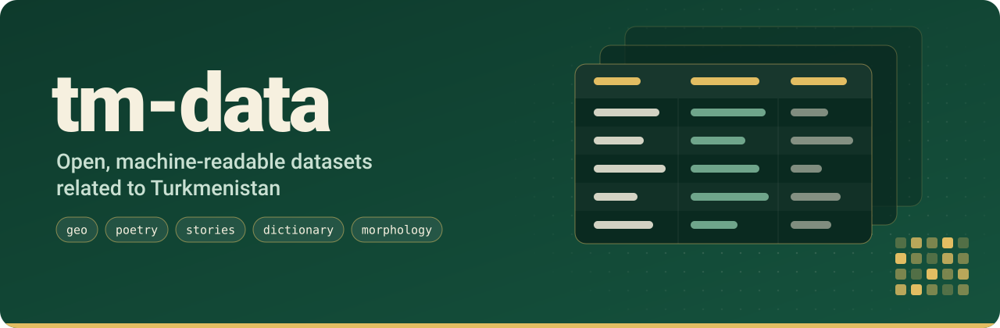

# tm-data



Open, machine-readable datasets related to Turkmenistan.

`tm-data` collects, organizes, and shares Turkmen data for use in software, research, data analysis, education, and machine learning.

## Datasets

| Dataset | Contents | Format | Documentation |
| --- | --- | --- | --- |
| Geography | Administrative divisions, settlements, alternative names, and [multilingual search](geo/search/README.md) | GeoJSON, JSON, PostgreSQL, MySQL, SQLite, SQL Server | [Guide](geo/README.md) |
| Poetry | 855 works by 13 Turkmen poets | MySQL 8+ SQL, JSON | [Guide](poetry/README.md) |
| Stories | Page-level text extracted from Turkmen stories and prose | JSON, SQLite, MySQL SQL | [Guide](stories/README.md) |
| Colors | Turkmen color names, English translations, HEX values, and categories | MySQL 8+ SQL, JSON, CSV | [Guide](utils/colors/README.md) |
| Dictionary | 18,674 searchable Turkmen headwords with pronunciations, definitions, and examples | JSON | [Guide](dictionary/README.md) |
| Given names | 447 Turkmen names with meaning, origin, gender, variants, and provenance status | JSON | [Guide](utils/names/README.md) |
| Morphology | 25 suffix families, 50 noun/verb analyses, harmony rules, and selected exceptions | JSON | [Guide](language/morphology/README.md) |
| Riddles | 10 original Turkmen riddles with answers, categories, and source metadata | JSON | [Guide](utils/riddles/README.md) |

Each dataset documents its structure, import process, limitations, and available sources in its own directory.

Flat utility datasets also provide deterministic UTF-8 CSV exports for users
who do not need JSON or SQL. See the [CSV export guide](tools/csvexports/README.md)
for coverage, representation rules, and regeneration commands.

See [DATA_FORMAT.md](DATA_FORMAT.md) for shared encoding, field naming, date, and export conventions.

## Usage

Clone the repository:

```sh
git clone https://github.com/turkmenos/tm-data.git
cd tm-data
```

Follow the import instructions for the dataset you want to use. SQL files use UTF-8; choose a connection encoding and collation that preserve Turkmen characters such as `ä`, `ç`, `ň`, `ö`, `ş`, `ü`, `ý`, and `ž`.

### Geographic search

Search 2,711 administrative divisions and settlements by canonical name or
existing alias. The [geographic search index](geo/search/README.md) preserves
original Turkmen names, stable identifiers, verification status, and source metadata.

Run the Go tool from the repository root (Go 1.23 or later):

```sh
# Match an existing English alias or an ASCII-normalized name
go run ./tools/geosearch --query Ashgabat
go run ./tools/geosearch --query asgabat

# Search existing Cyrillic names
go run ./tools/geosearch --query 'Ашхабад'

# Enable prefix matching and filter by administrative type
go run ./tools/geosearch --query das --prefix --type welayat

# Filter by ancestor region, or enable approximate matching
go run ./tools/geosearch --query asgabat --parent turkmenistan-lebap
go run ./tools/geosearch --query Ashgabatx --fuzzy
```

Matching is Unicode-aware and case-insensitive. Duplicate place names remain
separate results identified by their slugs. Prefix and fuzzy matching are
optional; fuzzy results can be ambiguous and do not establish a place's identity.
Existing Cyrillic aliases retain their recorded language, and no new names or
administrative relationships are inferred.

Use `--verified-only` to restrict results to verified region records. Alias
records have no separate verification status. See the [search guide](geo/search/README.md)
for JSON requests, result fields, ranking, and provenance limitations.

Regenerate and check the index after changing geographic source data:

```sh
go run ./tools/geosearch
go run ./tools/geosearch --check
go test ./tools/geosearch
```

## Machine-readable catalog

[`catalog.json`](catalog.json) lists all dataset directories and data files,
available formats, content-based versions, per-file record counts (or `null`
when unknown), and documentation/provenance references. See the
[catalog guide](tools/catalog/README.md) for the schema and counting rules.

After changing datasets, regenerate and verify the inventory:

```sh
go run ./tools/catalog
go run ./tools/catalog --check
```

## Dataset versions and changelog

Dataset versions are the content fingerprints in [`catalog.json`](catalog.json).
[`CHANGELOG.md`](CHANGELOG.md) summarizes dataset changes between commits on
`main`, with matching machine-readable reports in [`changes/`](changes/README.md),
which also documents the versioning and breaking-change rules. Compare any two
revisions:

```sh
go run ./tools/changelog --from main~1 --to main
go run ./tools/changelog --from <base> --to HEAD --format markdown
```

Every pull request gets a dataset change summary and a `dataset-change-report`
workflow artifact. See the [changelog tool guide](tools/changelog/README.md).

## Data quality checks

Repository-wide duplicate and format validation is available in
[`tools/validate/main.go`](tools/validate/main.go). It checks JSON, JSONL, and
CSV datasets, including GeoJSON, using only the Go standard library:

```sh
go run ./tools/validate/main.go
```

Specific files or directories can be passed as arguments. The validator exits
with status `1` when it finds duplicate records, duplicate JSON keys, invalid
UTF-8, or malformed JSON, JSONL, or CSV. It is original repository tooling,
uses only the Go standard library, and does not contain or download external
data; dataset provenance remains documented with each dataset.

Strict UTF-8 and modern Turkmen Latin alphabet validation is available in
[`tools/validation`](tools/validation/README.md):

```sh
go run ./tools/validation -text "Türkmenistanyň paýtagty Aşgabat."
```

Machine-readable, conservative Turkmen text normalization rules and fixtures
are documented in [`utils/normalization`](utils/normalization/README.md). A
reference implementation provides UTF-8 validation, BOM handling, LF line
endings, and Unicode NFC without changing spelling or script:

```sh
go run ./tools/normalization -text $'A\u0308new\r\n'
go run ./tools/normalization --check
```

Schema, required-field, uniqueness, range, and cross-file reference checks are
defined in [`tools/integrity/rules.json`](tools/integrity/rules.json) and run with:

```sh
go run ./tools/integrity
```

Curated noun and verb segmentation, harmony, compatibility, and stem-change checks:

```sh
go run ./tools/morphology
```

See the [morphology guide](language/morphology/README.md) for coverage and verification limits.

### Quality report

[`reports/quality/summary.json`](reports/quality/README.md) combines the format
and integrity checks above into one machine-readable report with per-dataset
record counts, check results, error and warning lists, and metrics such as
unverified records, missing source metadata, and missing coordinates. CI fails
on errors, treats documented gaps as warnings, and uploads the fresh report as
the `dataset-quality-report` workflow artifact.

```sh
go run ./tools/quality
go run ./tools/quality --check
```

See the [quality tool guide](tools/quality/README.md) for configuration and exit codes.

## Contributing

Contributions may include new datasets, corrections, sources, translations, or additional export formats.

1. Place data in an appropriately named directory and use a clear, machine-readable structure.
2. Document the source URL, retrieval date, and redistribution rights.
3. Describe the schema, format, import steps, and known limitations in the dataset README.
4. Preserve the Turkmen alphabet in UTF-8 and check for duplicates where possible.
5. Do not include private, sensitive, or non-redistributable data.
6. Regenerate affected exports, the dataset catalog, and the quality report, then run the relevant validation checks.

## Roadmap

See [ROADMAP.md](ROADMAP.md) for the planned datasets, data quality improvements, export formats, and usage documentation.

### Ideas for future datasets

- Topic labels for proverbs and sayings; expand the riddles collection
- Expand Turkmen given names with reviewed meanings, origins, and sources
- District codes, postal codes, and telephone codes
- Holidays, historical dates, and cultural heritage sites
- Thematic vocabulary for animals, plants, food, occupations, and family relationships
- Expand the Turkmen morphology dataset with additional suffixes and reviewed analyses
- Extend automated schema, encoding, duplicate, and integrity checks

For any new dataset, reliable provenance, redistribution rights, and verification status are more important than record count alone.

## Sources and license

General provenance guidelines are available in [SOURCES.md](SOURCES.md). Detailed sources are documented within each dataset when available.

The repository's original code and independently created material are provided under the [MIT License](LICENSE). External data, source material, and literary works may have separate licenses or copyright restrictions. Review each dataset's documentation before use or redistribution.
