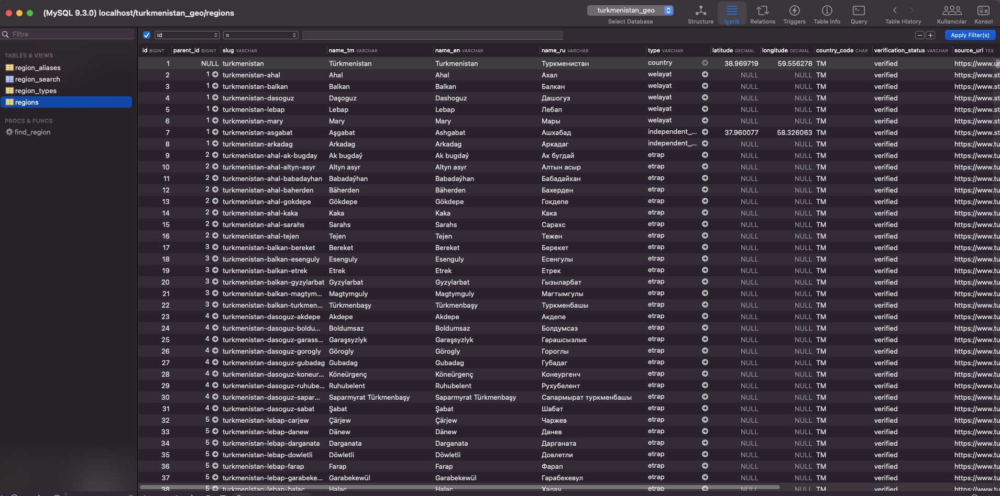
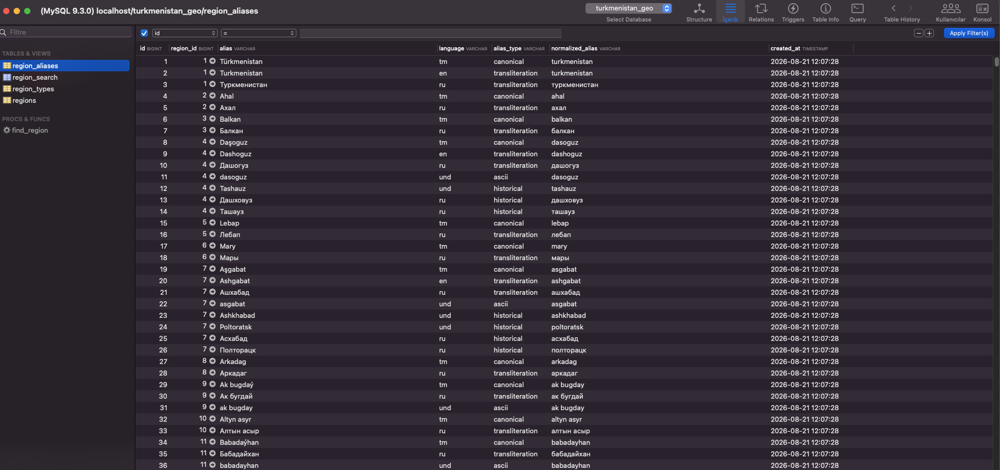
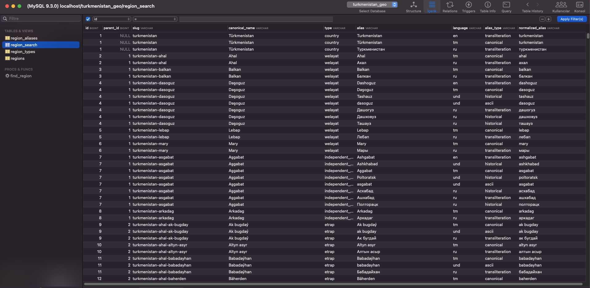

# geo

Ready-to-import SQL datasets for the administrative geography and settlements of Turkmenistan.

Supports PostgreSQL, MySQL, SQLite, and SQL Server. Each database is provided as a standalone `import.sql` file containing the schema, indexes, search helpers, and seed data.

## Choose a language

| Language | Instructions | Sources |
| --- | --- | --- |
| 🇬🇧 English | [English import guide](source/en/README.md) | [English sources](source/en/SOURCES.md) |
| 🇹🇲 Türkmençe | [Türkmençe import gollanmasy](source/tm/README.md) | [Türkmençe çeşmeler](source/tm/SOURCES.md) |

## Download

Choose your database and use its `import.sql` file:

| Database | Import file |
| --- | --- |
| PostgreSQL 14+ | [`sql/postgresql/import.sql`](sql/postgresql/import.sql) |
| MySQL 8+ | [`sql/mysql/import.sql`](sql/mysql/import.sql) |
| SQLite 3.24+ | [`sql/sqlite/import.sql`](sql/sqlite/import.sql) |
| SQL Server 2017+ | [`sql/sqlserver/import.sql`](sql/sqlserver/import.sql) |

Each file includes:

- Database schema
- Administrative region data
- Region aliases
- Indexes
- Search helpers
- Seed data

Imports are idempotent and can be safely run again without creating duplicate regions or aliases.

## JSON

A JSON export, generated from the SQL seed data, is also available for applications that don't use a database:

| File | Contents |
| --- | --- |
| [`json/regions.json`](json/regions.json) | 2,711 administrative regions and settlements |
| [`json/region_aliases.json`](json/region_aliases.json) | 7,494 aliases (canonical names, transliterations, ASCII forms, historical names) |
| [`json/region_types.json`](json/region_types.json) | The 8 region types and their descriptions |

See [`json/README.md`](json/README.md) for the schema, and [Known data notes](#known-data-notes) below for data-quality findings surfaced while generating this export.

## Preview

<table>
  <tr>
    <td align="center">
       
      <b>Regions</b>
    </td>
    <td align="center">
       
      <b>Region Aliases</b>
    </td>
    <td align="center">
       
      <b>Region Search</b>
    </td>
  </tr>
</table>

## Known data notes

These were found while generating the JSON export in [`json/`](json) by parsing [`sql/sqlite/import.sql`](sql/sqlite/import.sql) and checking the result for referential integrity, duplicates, and outliers. They are characteristics of the existing SQL seed data, preserved as-is in the JSON rather than silently corrected, per the guidance in [`CONTRIBUTING.md`](../CONTRIBUTING.md). Most trace back to the same source: the [OSM wiki rural-council compilation](https://wiki.openstreetmap.org/wiki/Districts_in_Turkmenistan) cited in [Sources](source/en/SOURCES.md), which was scraped for village and rural-council data.

- **A grammar/glossary table was scraped as if it were place data.** Four records — one `rural_council` named `geňeşlik (possessive geňeşligi)` and three `village` children named `oba (possessive obasy)`, `şäher (possessive şäheri)`, and `şäherçe (possessive şäherçesi)` — are not real places. Turkmen `geňeşlik`, `oba`, `şäher`, and `şäherçe` are the words for "rural council", "village", "city", and "town"; `genesligi`/`obasy`/`saheri`/`sahercesi` are their possessive forms. This looks like a declension-pattern legend from the source wiki page that was ingested as if each row were a place. All four have `verification_status: "verification_required"` and no coordinates. Slugs: `turkmenistan-geneslik-possessive-genesligi` and its three children.
- **87 villages (plus the rural council above) are attached directly to the country record, bypassing welayat/etrap/rural-council.** `regions.json` is a tree rooted at the `turkmenistan` record; every other record reaches that root through a `parent_slug` chain. 98 records have `parent_slug: "turkmenistan"` directly — but only 7 of those (the 5 welayat and 2 independent cities) are structurally correct there. The other 91 (90 `village` + the 1 fake `rural_council` above) are missing the welayat → etrap → rural-council ancestors every other village has, so a query that walks the hierarchy (e.g. "list all villages in Ahal welayat") will silently miss them. Two of the 90, `turkmenistan-kesler` and `turkmenistan-kesler-village`, are a clear example: both are named `Keşler`, both cite an OpenStreetMap source (a node and a way, about 100m apart), and both are plausible real villages — they just never got linked to their actual rural council.
- **10 regions (and 20 of their aliases) are administrative placeholders, not place names.** Names like `Village merged into Janybek and deleted from list.` and `Dostluk Merged with Täzedaýhan.` are editorial notes about a village's fate, stored as if they were the village's own name — likely carried over verbatim from the source compilation's remarks column. One side effect: the dataset's automatic Russian transliteration was applied to this English sentence letter-by-letter, producing nonsense Cyrillic such as `Виллаге мергед инто жаныбек анд делетед фром лист.` (a phonetic, non-semantic rendering of "Village merged into Janybek..."), stored with `language: "ru"`. Code that assumes every `ru`-tagged alias is genuine Russian should be aware of this. One rural council (`turkmenistan-dasoguz-sabat-sabat-hasylcy`) has seven such placeholder children, all sharing the same "abolished" note, differentiated only by a numeric slug suffix.
- **A `tools/integrity` limitation, not a data issue:** the `ranges` check in `tools/integrity/main.go` treats a JSON `null` as a present value, so applying a `-90..90` / `-180..180` range rule to the nullable `latitude`/`longitude` fields flagged all 1,225 regions with unknown coordinates as invalid. The SQL schema already enforces these bounds with `CHECK` constraints at the database level, so no out-of-range coordinate values actually exist in this export — this is purely a gap in how the shared validator handles optional numeric fields. Rather than patch shared tooling for this export, `tools/integrity/rules.json` omits a `ranges` rule for these two fields; see that file's `geo/json/regions.json` entry.